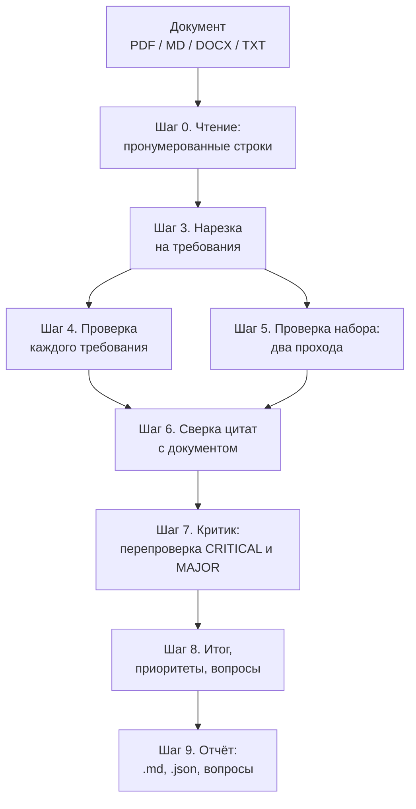

# reqask: агент проверки требований

Агент читает документ с требованиями (PDF, Markdown, DOCX, TXT), делит его на отдельные требования, проверяет каждое требование и весь набор по ISO/IEC/IEEE 29148:2018 и IEEE Std 830-1998 и пишет отчёт на русском языке.

Это ревью требований до разработки. Агент ищет дефекты формулировок: двусмысленность, непроверяемость, противоречия, пропуски, лишние проектные решения. Каждое замечание ссылается на строку документа и приводит дословную цитату.

Решение для хакатона BCC-HUB x MNU FinTech Hackathon, задание: [ai-requirements-validator-task](https://github.com/BCC-HUB/ai-requirements-validator-task).

## Запуск

Нужен Python 3.10 или новее.

**0. Выбрать, как запускать: uv или venv.** С [uv](https://docs.astral.sh/uv/) окружение и зависимости создаются сами, команды ниже начинаются с `uv run`. Установка uv одной строкой:

```bash
curl -LsSf https://astral.sh/uv/install.sh | sh
```

Без uv один раз создайте окружение и поставьте зависимости:

```bash
python3 -m venv .venv && source .venv/bin/activate && pip install -e .
```

В Windows активация выглядит так: `.venv\Scripts\activate`. Дальше вместо `uv run main.py` пишите `python main.py`. В новом терминале сначала снова активируйте `.venv`.

**1. Получить ключ модели.** Откройте [Google AI Studio](https://aistudio.google.com/), нажмите Get API key и создайте ключ. Бесплатного тарифа хватает на один прогон в сутки: лимит 20 запросов в день на модель, прогону нужно 13-14. Когда серверы Gemini перегружены и отвечают ошибками, квота уходит на повторы, и прогон может остановиться с неполным отчётом. Отчёт в `reports/` сделан на `claude-haiku-5-5` с ключом Anthropic: этот путь проверен полными прогонами. Другие провайдеры (Anthropic, OpenAI, Ollama, любой OpenAI-совместимый адрес) описаны в `.env.example`.

**2. Положить ключ в `.env`.**

```bash
cp .env.example .env
```

Откройте `.env` и впишите ключ в строку `GEMINI_API_KEY=`. Файл `.env` в Git не попадает.

**3. Проверить ключ.** Один короткий вызов, без документа:

```bash
uv run main.py --check
```

Команда скажет, принят ли ключ и какая модель отвечает. Если основная модель не отвечает, проверка идёт по запасным и пишет, на какой пойдёт прогон. Без uv то же самое в окружении из шага 0: `python main.py --check`.

**4. Запустить прогон одной командой.**

С uv:

```bash
uv run main.py --input input/requirements.md --output reports/report.md
```

Без uv, в окружении из шага 0:

```bash
python main.py --input input/requirements.md --output reports/report.md
```

`--input` принимает путь к документу требований, `--output` путь к файлу отчёта. PDF передаётся так же: `--input spec.pdf`.

**Куда ляжет отчёт.** В файл из `--output` (в примере `reports/report.md`). Рядом агент сохраняет те же данные в машинном виде, `reports/report.json`, и отдельный список вопросов автору, `reports/report.questions.md`.

Прогон выданного документа (198 строк) на `claude-haiku-5-5` делает 13-14 обращений к модели, идёт 10-12 минут и тратит около 340 тысяч токенов. Ход прогона печатается в консоль. Готовый отчёт по этому документу лежит в [reports/report.md](reports/report.md).

## Модель

По умолчанию `gemini-3.8-flash` через Gemini API (бесплатный тариф). Модель задаётся в `.env` переменной `GEMINI_MODEL` или флагом `--model`.

У Gemini есть запасные модели: `gemini-3.6-flash`, `gemini-3.7-flash`, `gemini-3.5-flash`. Если модель не отвечает или у неё кончилась суточная квота, агент сам переходит на следующую. Список меняется переменной `GEMINI_FALLBACK_MODELS`, для других провайдеров есть `LLM_FALLBACK_MODELS`. Значение `none` выключает переход.

Агент работает с любым провайдером, у которого есть OpenAI-совместимый API. Он берёт первый заполненный вариант по порядку: `LLM_*`, `GEMINI_*`, `ANTHROPIC_*`, `OPENAI_*`, `OLLAMA_*`. Варианты для Anthropic, OpenAI, Ollama и произвольного адреса описаны в `.env.example`.

## Как устроен агент



Номера шагов те же, что в логе прогона и в паспорте отчёта. Шаги 1, 2 и 5в (структурные проверки кодом, контекст документа, чек-лист ревью) в этой версии выключены и в логе помечены «не включён». Словарь расплывчатых формулировок работает внутри шага 4.

1. **Шаг 0. Чтение.** Документ превращается в пронумерованные строки. Номер строки служит адресом для цитат и ссылок.
2. **Шаг 3. Нарезка.** Модель возвращает только границы требований (номера строк), идентификатор из документа и краткую суть. Текст требования агент вырезает из документа сам, поэтому цитаты в отчёте дословные.
3. **Шаг 4. Проверка каждого требования.** Требования идут порциями (по умолчанию 6 штук). К каждому приложены подсказки линтера расплывчатых слов (п. 5.2.7 ISO 29148) и текст документа для контекста. Модель возвращает дефекты: критерий, критичность, цитату, описание, рекомендацию и исправленную формулировку.
4. **Шаг 5. Проверка набора.** Два отдельных прохода по всему документу. Первый ищет только противоречия и расхождения между разделами. Второй проверяет полноту, осуществимость, понятность, валидируемость, ранжированность, модифицируемость и прослеживаемость.
5. **Шаг 6. Сверка цитат.** Каждая цитата модели ищется в документе обычным кодом. Не нашлась дословно: агент ищет близкий фрагмент и подставляет настоящую строку документа. Замечание по набору без подтверждённой цитаты и без ссылки на требование в отчёт не попадает. Счётчики сверки видны в паспорте прогона.
6. **Шаг 7. Критик.** Второй проход модели перепроверяет каждое замечание уровня CRITICAL и MAJOR и решает по нему: оставить, понизить уровень, снять или слить с другим замечанием. Снятые и слитые замечания видны в приложении отчёта. Шаг выключается флагом `--no-critic` или переменной `REQASK_CRITIC=0`.
7. **Шаг 8. Итог.** Готовность к разработке и тестированию считает простое правило по числу критичных замечаний, оно записано в отчёте. Модель пишет обоснование, порядок исправлений и сводные вопросы автору, ссылаться она может только на существующие замечания.
8. **Шаг 9. Отчёт.** Командная строка записывает отчёт `.md`, машинный `.json` и файл вопросов автору.

### Что происходит при сбоях модели

- Ответ модели обязан быть JSON по схеме (pydantic). Невалидный ответ возвращается модели вместе с текстом ошибки, до двух попыток исправления.
- Минутный лимит запросов (429), ошибки сервера и обрывы связи: повтор с растущей паузой на той же модели.
- Суточная квота исчерпана, модель не отвечает после повторов или держит лимит: агент переходит на следующую запасную модель и продолжает прогон. Переход записан в паспорте отчёта.
- Запасных моделей нет или они кончились: агент останавливается и пишет, что нужно сменить модель (`--model`), ключ или уровень оплаты. Проверенные шаги берутся из кэша, поэтому повторный запуск продолжает с места остановки.
- Провайдер не принимает режим JSON-схемы, `temperature` или `reasoning_effort`: агент сам отключает неподдерживаемое и продолжает.
- Порция требований не прошла (обрезан ответ, битый JSON): порция делится пополам. Модель пропустила часть требований: по ним идёт отдельный запрос.
- Шаг не удался совсем: прогон продолжается, а в начале отчёта появляется блок «Отчёт неполный» со списком того, что не проверено. Код возврата в этом случае 3.
- Отчёт неполный и в проверенной части нет критичных дефектов: вердикт «Не вынесен», готовность «Не определена». Положительного решения по неполным данным агент не даёт.
- Проверенные ответы модели кэшируются в `.reqask_cache/`. Повторный запуск после сбоя продолжает с места остановки и не тратит квоту. Флаг `--no-cache` отключает кэш.

## Критерии

Для отдельного требования (ISO/IEC/IEEE 29148:2018 п. 5.2.5, IEEE 830 п. 4.3) агент проверяет девять критериев: необходимость, уместность уровня, однозначность, полнота, атомарность, осуществимость, проверяемость, корректность, непротиворечивость.

Соответствие оформлению (есть идентификатор, понятная структура формулировки, модальность: должен, может, запрещено) проверяет код один раз на весь набор, модели этот критерий не передаётся.

Для набора (ISO/IEC/IEEE 29148:2018 п. 5.2.6, IEEE 830 п. 4.3): полнота, согласованность, осуществимость, понятность, валидируемость, ранжированность, модифицируемость, прослеживаемость.

Определения лежат в одном месте, [src/reqask/criteria.py](src/reqask/criteria.py). Из него собираются промпты, схемы ответа и приложение в отчёте.

Критичность: CRITICAL блокирует разработку или тестирование, MAJOR несёт риск разного понимания и переделок, MINOR касается оформления.

## Состав отчёта

Первый экран, до разделов: вердикт, готовность к разработке и тестированию, счётчики, список блокеров и главные вопросы автору ТЗ. Дальше:

1. Паспорт прогона: документ, дата, модель, версия агента (коммит), статистика обращений, сверки цитат и работы критика, журнал шагов.
2. Нарезка на требования: идентификатор в отчёте, идентификатор в документе, раздел, строки, краткая формулировка.
3. Проверка каждого требования: оценки по критериям значками и разбор замечаний с цитатами, вопросом и готовой формулировкой. Требования без замечаний идут одним списком.
4. Проверка набора требований целиком.
5. Сводка: число требований и замечаний, разбивка по критичности и критериям.
6. Вердикт: можно ли начинать разработку и тестирование, что исправить в первую очередь.
7. Вопросы к автору ТЗ: что сейчас написано в документе, варианты ответа и последствие каждого. Те же вопросы лежат отдельным файлом `report.questions.md`.

Приложение А: критерии и уровни критичности. Приложение Б: замечания, которые критик снял или слил с другими, и неподтверждённые цитатами.

## Параметры командной строки

| Флаг | Назначение |
| :--- | :--- |
| `--input`, `-i` | документ требований: PDF, Markdown, DOCX или TXT |
| `--output`, `-o` | файл отчёта, расширение `.md` |
| `--check` | проверить ключ и модель одним коротким вызовом, без документа |
| `--model` | модель вместо значения из `.env` |
| `--env-file` | другой файл с ключом (по умолчанию `.env` в текущей папке) |
| `--batch-size` | сколько требований проверять одним запросом |
| `--no-cache` | не брать ответы модели из кэша и не писать в него |
| `--no-critic` | не запускать шаг 7, перепроверку CRITICAL и MAJOR |
| `--no-json` | не сохранять `report.json` рядом с отчётом |
| `--fail-on-critical` | код возврата 10, если вердикт «Не рекомендуется начинать» (для CI) |
| `--quiet`, `-q` | не печатать ход прогона |

Остальные настройки (повторы, таймаут, пауза между запросами, параллельность, папка кэша, критик) задаются в `.env`, список есть в `.env.example`.

## Встраивание в CI

Агент годится как проверка документа перед началом работ. Коды возврата:

| Код | Что значит |
| :--- | :--- |
| 0 | отчёт записан полностью |
| 3 | отчёт записан, но неполный: часть шагов не выполнена, причина в начале отчёта |
| 2 | ошибка входа или настроек |
| 1 | модель недоступна, отчёта нет |
| 10 | только с `--fail-on-critical`: вердикт «Не рекомендуется начинать» |
| 130 | прогон прерван |

С флагом `--fail-on-critical` шаг сборки падает кодом 10, если в документе есть критичные дефекты:

```bash
uv run main.py --input input/requirements.md --output reports/report.md --fail-on-critical
```

## Проверка на чужом документе

Агент не настроен под выданный документ. Он проверен на чужой спецификации из открытого набора PURE: другой автор, другая область, английский язык, настоящий PDF с таблицами, колонтитулами и оглавлением. Отчёт агента по ней лежит в [examples/pure-puget-sound.report.md](examples/pure-puget-sound.report.md). Сам PDF в репозиторий не положен: в [examples/README.md](examples/README.md) написано, где его взять и как запустить прогон. Тест [tests/test_no_overfit.py](tests/test_no_overfit.py) программно проверяет, что идентификаторов, путей, имён полей и чисел из выданного документа нет ни в одном модуле агента.

## Структура репозитория

```text
main.py                  точка входа
src/reqask/
  cli.py                 разбор аргументов, запись отчёта
  config.py              настройки из .env
  loader.py              чтение PDF, Markdown, DOCX, TXT в строки
  criteria.py            справочник критериев
  prompts.py             промпты шагов
  schemas.py             схемы ответов модели и результата
  llm.py                 клиент модели: JSON, повторы, кэш
  lint.py                линтер расплывчатых формулировок
  grounding.py           сверка цитат с документом
  pipeline.py            шаги прогона
  report.py              сборка отчёта в Markdown
tests/                   тесты без сети, модель подменена заглушкой
input/requirements.md    документ, выданный организаторами
examples/                отчёт агента по чужому документу и где взять сам документ
```

## Тесты

```bash
uv run pytest
```

Тесты не ходят в сеть и не требуют ключа. Отдельно `tests/test_no_overfit.py` проверяет, что код не привязан к выданному документу.

## Ограничения

- PDF читается по текстовому слою. Скан без распознанного текста агент не примет и скажет об этом.
- Таблицы PDF сохраняются как таблицы Markdown. Таблицу, разорванную границей страницы, агент не склеивает в одну.
- Заголовки в PDF распознаются по нумерации и по словам вроде «Раздел» и «Приложение» (`1.2 Название`, `Раздел 3`, `Приложение А`), а не по размеру шрифта. Заголовок без номера и без такого слова агент не выделит.
- Составное слово, которое пишется через дефис и разорвано переносом строки, агент склеивает без дефиса: отличить перенос от настоящего дефиса внутри слова он не умеет.
- Отчёт и вопросы автору всегда на русском, на каком бы языке ни был документ. На языке требования пишется только готовая исправленная формулировка: её можно вставить в документ как есть.
- Содержание замечаний зависит от модели. Агент проверяет кодом то, что можно проверить: формат ответа, цитаты, ссылки на требования. Смысл замечаний перед использованием стоит просмотреть аналитику.
