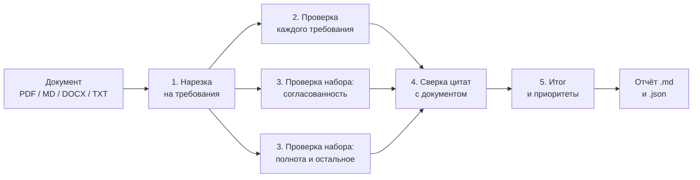

# reqask: агент проверки требований

Агент читает документ с требованиями (PDF, Markdown, DOCX, TXT), делит его на отдельные требования, проверяет каждое требование и весь набор по ISO/IEC/IEEE 29148:2018 и IEEE Std 830-1998 и пишет отчёт на русском языке.

Это ревью требований до разработки. Агент ищет дефекты формулировок: двусмысленность, непроверяемость, противоречия, пропуски, лишние проектные решения. Каждое замечание ссылается на строку документа и приводит дословную цитату.

Решение для хакатона BCC-HUB x MNU FinTech Hackathon, задание: [ai-requirements-validator-task](https://github.com/BCC-HUB/ai-requirements-validator-task).

## Запуск

Нужен Python 3.10 или новее.

**1. Получить ключ модели.** Откройте [Google AI Studio](https://aistudio.google.com/), нажмите Get API key и создайте ключ. Бесплатного тарифа хватает.

**2. Положить ключ в `.env`.**

```bash
cp .env.example .env
```

Откройте `.env` и впишите ключ в строку `GEMINI_API_KEY=`. Файл `.env` в Git не попадает.

**3. Запустить прогон одной командой.**

С [uv](https://docs.astral.sh/uv/) (сам создаст окружение и поставит зависимости):

```bash
uv run main.py --input input/requirements.md --output reports/report.md
```

Без uv:

```bash
python -m venv .venv && source .venv/bin/activate && pip install -e .
```

```bash
python main.py --input input/requirements.md --output reports/report.md
```

`--input` принимает путь к документу требований, `--output` путь к файлу отчёта. PDF передаётся так же: `--input spec.pdf`.

**Куда ляжет отчёт.** В файл из `--output` (в примере `reports/report.md`). Рядом агент сохраняет те же данные в машинном виде: `reports/report.json`.

Прогон документа на 200 строк делает около 12 обращений к модели и занимает несколько минут. Ход прогона печатается в консоль.

## Модель

По умолчанию `gemini-3.8-flash` через Gemini API (бесплатный тариф). Модель задаётся в `.env` переменной `GEMINI_MODEL` или флагом `--model`.

Агент работает с любым провайдером, у которого есть OpenAI-совместимый API. Варианты для OpenAI, Ollama и произвольного адреса описаны в `.env.example`.

## Как устроен агент



1. **Чтение.** Документ превращается в пронумерованные строки. Номер строки служит адресом для цитат и ссылок.
2. **Нарезка.** Модель возвращает только границы требований (номера строк), идентификатор из документа и краткую суть. Текст требования агент вырезает из документа сам, поэтому цитаты в отчёте дословные.
3. **Проверка каждого требования.** Требования идут порциями по 6 штук. К каждому приложены подсказки линтера (расплывчатые слова из п. 5.2.7 ISO 29148) и текст документа для контекста. Модель возвращает дефекты: критерий, критичность, цитату, описание, рекомендацию и исправленную формулировку.
4. **Проверка набора.** Два отдельных прохода по всему документу. Первый ищет только противоречия и расхождения между разделами. Второй проверяет полноту, осуществимость, понятность, валидируемость, ранжированность, модифицируемость и прослеживаемость.
5. **Сверка цитат.** Каждая цитата модели ищется в документе обычным кодом. Не нашлась дословно: агент ищет близкий фрагмент и подставляет настоящую строку документа. Замечание по набору без подтверждённой цитаты и без ссылки на требование в отчёт не попадает. Счётчики сверки видны в паспорте прогона.
6. **Итог.** Готовность к разработке и тестированию считает простое правило по числу критичных замечаний, оно записано в отчёте. Модель пишет обоснование и порядок исправлений, ссылаться она может только на существующие замечания.

### Что происходит при сбоях модели

- Ответ модели обязан быть JSON по схеме (pydantic). Невалидный ответ возвращается модели вместе с текстом ошибки, до двух попыток исправления.
- Лимит запросов (429), ошибки сервера и обрывы связи: повтор с растущей паузой.
- Провайдер не принимает режим JSON-схемы, `temperature` или `reasoning_effort`: агент сам отключает неподдерживаемое и продолжает.
- Порция требований не прошла (обрезан ответ, битый JSON): порция делится пополам. Модель пропустила часть требований: по ним идёт отдельный запрос.
- Шаг не удался совсем: прогон продолжается, а в паспорте отчёта появляется блок «Неполнота прогона» со списком того, что не проверено.
- Проверенные ответы модели кэшируются в `.reqask_cache/`. Повторный запуск после сбоя продолжает с места остановки и не тратит квоту. Флаг `--no-cache` отключает кэш.

## Критерии

Для отдельного требования (ISO/IEC/IEEE 29148:2018 п. 5.2.5, IEEE 830 п. 4.3): необходимость, уместность уровня, однозначность, полнота, атомарность, осуществимость, проверяемость, корректность, соответствие оформлению.

Для набора (ISO/IEC/IEEE 29148:2018 п. 5.2.6, IEEE 830 п. 4.3): полнота, согласованность, осуществимость, понятность, валидируемость, ранжированность, модифицируемость, прослеживаемость.

Определения лежат в одном месте, [src/reqask/criteria.py](src/reqask/criteria.py). Из него собираются промпты, схемы ответа и приложение в отчёте.

Критичность: CRITICAL блокирует разработку или тестирование, MAJOR несёт риск разного понимания и переделок, MINOR касается оформления.

## Состав отчёта

1. Паспорт прогона: документ, дата, модель, версия агента (коммит), статистика обращений и сверки цитат.
2. Как агент нарезал требования: идентификатор в отчёте, идентификатор в документе, раздел, строки, краткая формулировка.
3. Проверка каждого требования: матрица «требование x критерий» и разбор с цитатами.
4. Проверка набора требований.
5. Сводка: число требований и нарушений, разбивка по критичности и критериям, список критичных дефектов.
6. Итог: можно ли начинать разработку и тестирование, что исправить в первую очередь.

## Параметры командной строки

| Флаг | Назначение |
| :--- | :--- |
| `--input`, `-i` | документ требований |
| `--output`, `-o` | файл отчёта |
| `--model` | модель вместо значения из `.env` |
| `--env-file` | другой файл с ключом |
| `--batch-size` | сколько требований проверять одним запросом |
| `--no-cache` | не использовать кэш ответов |
| `--no-json` | не сохранять `report.json` |
| `--quiet`, `-q` | не печатать ход прогона |

Остальные настройки (повторы, таймаут, пауза между запросами, параллельность) задаются в `.env`, список есть в `.env.example`.

## Структура репозитория

```text
main.py                  точка входа
src/reqask/
  cli.py                 разбор аргументов, запись отчёта
  config.py              настройки из .env
  loader.py              чтение PDF, Markdown, DOCX, TXT в строки
  criteria.py            справочник критериев
  prompts.py             промпты шагов
  schemas.py             схемы ответов модели и результата
  llm.py                 клиент модели: JSON, повторы, кэш
  lint.py                линтер расплывчатых формулировок
  grounding.py           сверка цитат с документом
  pipeline.py            шаги прогона
  report.py              сборка отчёта в Markdown
tests/                   тесты без сети, модель подменена заглушкой
input/requirements.md    документ, выданный организаторами
```

## Тесты

```bash
uv run pytest
```

Тесты не ходят в сеть и не требуют ключа.

## Ограничения

- PDF читается по текстовому слою. Скан без распознанного текста агент не примет и скажет об этом.
- Таблицы и схемы в PDF превращаются в обычный текст, структура таблиц при этом теряется.
- Содержание замечаний зависит от модели. Агент проверяет кодом то, что можно проверить: формат ответа, цитаты, ссылки на требования. Смысл замечаний перед использованием стоит просмотреть аналитику.
